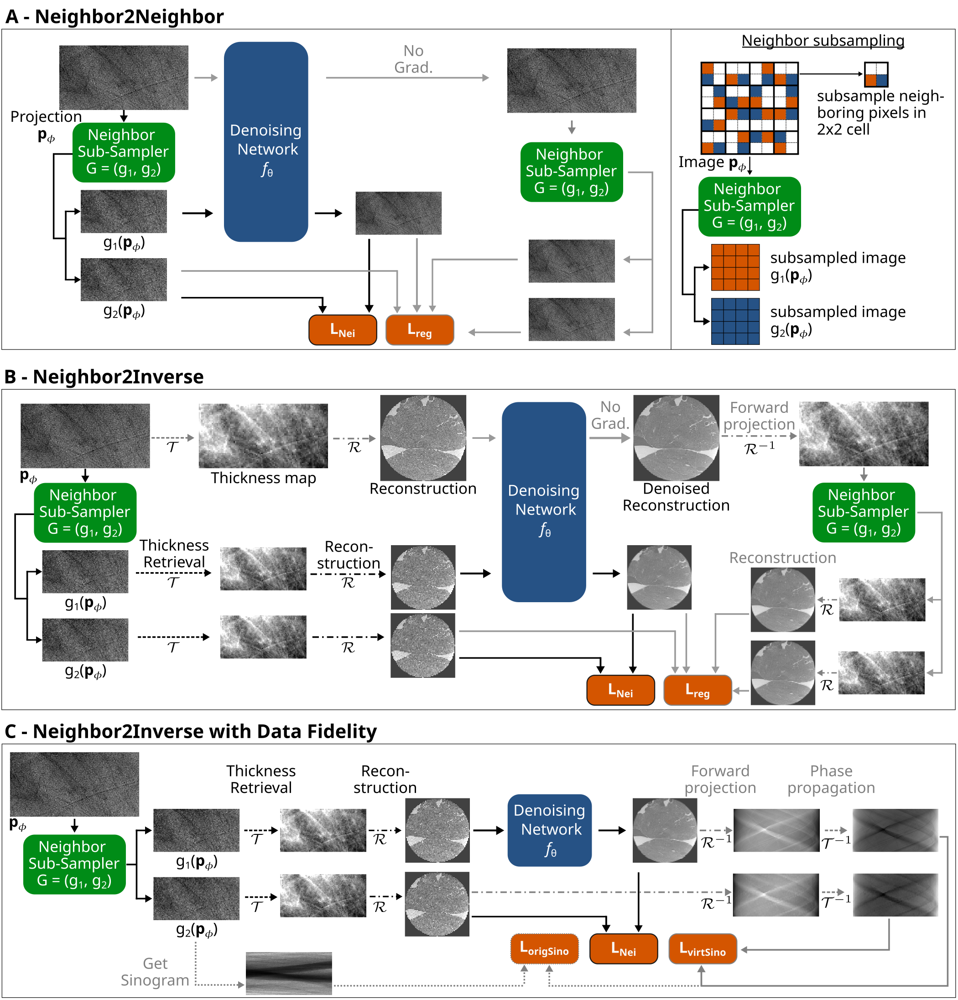
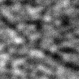

<link rel="preconnect" href="https://fonts.googleapis.com">
<link rel="preconnect" href="https://fonts.gstatic.com" crossorigin>
<link rel="stylesheet" href="https://fonts.googleapis.com/css2?family=Lato:ital,wght@0,400;0,700;1,400&display=swap">
<link rel="stylesheet" href="/assets/css/theme.css?v={{ site.time | date: '%s' }}">
<link rel="stylesheet" href="style.css?v={{ site.time | date: '%s' }}">

  <!-- ══════════ Top bar ══════════ -->
  <nav class="topbar">
    <a class="back-link" href="/"><svg width="16" height="16" viewBox="0 0 24 24" aria-hidden="true"><path d="M15 18l-6-6 6-6"/></svg>Johannes B. Thalhammer</a>
    <button class="theme-toggle" type="button" aria-label="Toggle light/dark mode">
      <svg class="icon-moon" width="16" height="16" viewBox="0 0 24 24" aria-hidden="true"><path d="M21 12.79A9 9 0 1 1 11.21 3 7 7 0 0 0 21 12.79z"/></svg>
      <svg class="icon-sun" width="16" height="16" viewBox="0 0 24 24" aria-hidden="true"><circle cx="12" cy="12" r="4"/><path d="M12 2v2M12 20v2M4.93 4.93l1.41 1.41M17.66 17.66l1.41 1.41M2 12h2M20 12h2M4.93 19.07l1.41-1.41M17.66 6.34l1.41-1.41"/></svg>
    </button>
  </nav>

  <!-- ══════════ Header ══════════ -->
  

    <h1>Neighbor2Inverse: Self-Supervised Denoising for Low-Dose ROI Phase Contrast CT</h1>
    

      Johannes B. Thalhammer, Tina Dorosti, Sebastian Peterhansl, Daniel Frey, Florian Schaff, Daniela Pfeiffer, Franz Pfeiffer, Martin Donnelley, Ronan Smith, Marcus Kitchen, Jannis Ahlers, Lucy Costello, Lorenzo D’Amico, Kaye Morgan
    

    
<em>Under submission</em>

    
<a href="https://github.com/J-3TO/Neighbor2Inverse" target="_blank" rel="noopener">code</a>

  

  <!-- ══════════ Abstract ══════════ -->
  

    <h2 class="label">Abstract</h2>
    
Propagation-based X-ray phase-contrast imaging (PBI) enables high-contrast visualization of lung structures and holds strong clinical potential. However, safe translation requires substantial radiation dose reduction, which inevitably increases image noise. Supervised Convolutional Neural Network-based denoising can restore image quality but depends on paired low- and high-dose datasets, which are rarely available in practice. Self-supervised methods avoid this limitation, yet most are not well adapted to the inverse problem of PBI computed tomography (CT).

    
We introduce <i>Neighbor2Inverse</i>, a self-supervised denoising framework for low-dose PBI CT. Building on the Neighbor2Neighbor principle, each noisy projection is subsampled into two variants that preserve structural information but contain independent noise realizations. These are reconstructed separately, and the resulting pairs are used to train a denoising network directly in the reconstruction domain. We systematically investigate multiple framework variants and benchmark against established denoising methods.

    
In region-of-interest PBI CT experiments, <i>Neighbor2Inverse</i> achieves superior noise suppression while maintaining fine structural details, as confirmed by visual assessment, increased contrast-to-noise ratio, enhanced spatial resolution, and improved composite image quality metrics.

    
Code and data are publicly available at <a href="https://github.com/J-3TO/Neighbor2Inverse" target="_blank" rel="noopener">github.com/J-3TO/Neighbor2Inverse</a>.

  

  

  

    <h3>Overview of the Neighbor2Inverse method</h3>
    
<strong>A</strong> – Neighbor2Neighbor approach in projection space. <strong>B</strong> – Neighbor2Inverse framework: Subsampling in projection space and denoising in reconstruction space. <strong>C</strong> – Neighbor2Inverse with data fidelity: Introducing data fidelity terms to constrict the denoising process.

  

  

    
  

  

  

    <h3>Comparison of denoising methods on reconstructed CT slices</h3>
    
Drag each slider to reveal the Low dose (15ms) image.

  

  

    <!-- Cells will be filled by JS -->
  

  

  

    <!-- Cells will be filled by JS -->
  

  

  

    <h3>Comparison of denoising methods on clinical CT pulmonary angiograms</h3>
    
Drag each slider to reveal the Low dose image.

  

  

    <!-- Cells will be filled by JS -->
  

  

  

    <h3>Denoising projections (15ms) by various methods.</h3>
    
Drag each slider to reveal the denoised image.

  

  

    
200ms

    
Gaussian Filter

    
BM3D

    
ProjFakeNoiseNet

    
Nei2Nei U-Net L2

    
Nei2Nei U-Net L1

    
Nei2Nei KBNet L2

    
Nei2Nei KBNet L1

  

  

    

      
    

    <!-- The next 7 cells will be filled by JS -->
  

  

  

    <h3>Comparison of different Neighbor2Inverse regularization and subsampling strategies</h3>
    
Drag each slider to reveal the denoised image.

  

  

    
200ms

    
15ms

    
proj. subsampling  LNei+Lreg

    
proj. subsampling  LNei

    
sino. subsampling  LNei

    
DataFidelityOrigSino  LNei+LorigSino

    
DataFidelityVirtSino  LNei+LvirtSino

  

  

  

  

    <h3>Denoising reconstructed CT images (15ms - 900 projs.) by various methods</h3>
    
Drag each slider to reveal the denoised image.

  

  

    
15ms -  1.800 projs.

    
15ms -  900 projs.

    
Nei2Nei

    
proj. subsampling  LNei

    
sino. subsampling  LNei

    
DataFidelityOrigSino  LNei+LorigSino

    
DataFidelityVirtSino  LNei+LvirtSino

  

  

  

  

    <h3>Denoising results of Neighbor2Inverse with different exposure times and projection views.</h3>
    
Drag each slider to reveal the denoised image.

  

  

    

      
1800 proj.

      
900 proj.

      
600 proj.

      
450 proj.

      
360 proj.

      
300 proj.

      
225 proj.

    

    

      
200ms

      
100ms

      
67ms

      
50ms

      
33ms

      
25ms

      
15ms

    

    

      <!-- Cells will be filled by JS -->
    

  

  <!-- ══════════ Footer ══════════ -->
  <footer class="site-footer">
    
© 2025 Neighbor2Inverse Project

  </footer>

<!-- Reference your main.js file at the end of the body -->

