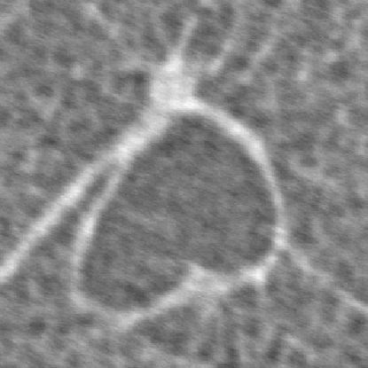
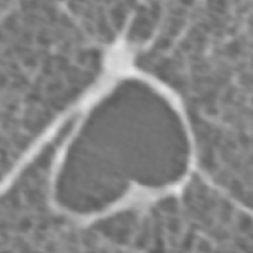
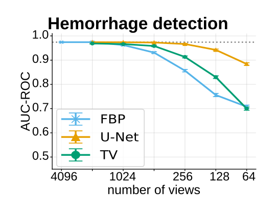

<link rel="preconnect" href="https://fonts.googleapis.com">
<link rel="preconnect" href="https://fonts.gstatic.com" crossorigin>
<link rel="stylesheet" href="https://fonts.googleapis.com/css2?family=Lato:ital,wght@0,400;0,700;1,400&display=swap">
<link rel="stylesheet" href="/assets/css/theme.css?v={{ site.time | date: '%s' }}">
<link rel="stylesheet" href="/assets/css/home.css?v={{ site.time | date: '%s' }}">

  <button class="theme-toggle" type="button" aria-label="Toggle light/dark mode">
    <svg class="icon-moon" width="16" height="16" viewBox="0 0 24 24" aria-hidden="true"><path d="M21 12.79A9 9 0 1 1 11.21 3 7 7 0 0 0 21 12.79z"/></svg>
    <svg class="icon-sun" width="16" height="16" viewBox="0 0 24 24" aria-hidden="true"><circle cx="12" cy="12" r="4"/><path d="M12 2v2M12 20v2M4.93 4.93l1.41 1.41M17.66 17.66l1.41 1.41M2 12h2M20 12h2M4.93 19.07l1.41-1.41M17.66 6.34l1.41-1.41"/></svg>
  </button>

  <!-- ══════════ Intro ══════════ -->
  

    

      <h1 class="name">Johannes B. Thalhammer</h1>
      
I am a doctoral candidate at the Chair of Biomedical Physics at the Technical University of Munich (TUM) and the Klinikum Rechts der Isar.

      
My research focuses on deep learning for medical X-ray imaging, in particular on reducing radiation dose in computed tomography: artifact reduction for sparse-view CT and self-supervised denoising for low-dose phase-contrast CT.

      

        <a href="mailto:johannes.thalhammer@tum.de">Email</a>/<a href="https://www.linkedin.com/in/johannes-thalhammer-72657922b" target="_blank" rel="noopener">LinkedIn</a>/<a href="https://github.com/J-3TO" target="_blank" rel="noopener">GitHub</a>
      

    

    
  

  <!-- ══════════ Research ══════════ -->
  <h2 class="section-title">Research</h2>
  <h3 class="subsection-title">First-author publications</h3>

  <!-- Paper with a before/after comparison slider as thumbnail.
       Images are the Neighbor2Inverse (ours) and Low dose (15ms) panels of the
       first comparison figure on the demo page (SliceDenoisingCompMethods_updated/image_1).
       The "compare-top" image is shown left of the divider. -->
  

    

      
      
      Denoised
      Low dose
      <svg width="12" height="12" viewBox="0 0 24 24" aria-hidden="true"><path d="M9 6l-6 6 6 6M15 6l6 6-6 6"/></svg>
      <input class="compare-range" type="range" min="0" max="100" value="50" aria-label="Slide to compare the denoised result with the low-dose input">
    

    

      <a class="pub-title" href="/Neighbor2Inverse/">Neighbor2Inverse: Self-Supervised Denoising for Low-Dose ROI Phase Contrast CT</a>
      
Johannes B. Thalhammer, Lorenzo D'Amico, Lucy Costello, Sebastian Peterhansl, Tina Dorosti, Florian Schaff, Jannis Ahlers, Ronan Smith, Marcus Kitchen, Franz Pfeiffer, Martin Donnelley, Daniela Pfeiffer, Kaye S. Morgan

      
<em>Under submission</em>

      
<a href="/Neighbor2Inverse/">project page</a>/<a href="https://github.com/J-3TO/Neighbor2Inverse" target="_blank" rel="noopener">code</a>

      
Each noisy projection is split into two subsampled copies with independent noise. Both are reconstructed, and a denoiser is trained on the resulting slice pairs, with no high-dose reference scans required.

    

  

  <!-- Paper without an image: text tile. To add an image, replace the tile div with
       

 -->
  

    

      arXiv
      2026
    

    

      <a class="pub-title" href="https://arxiv.org/abs/2602.08727" target="_blank" rel="noopener">Artifact Reduction in Undersampled 3D Cone-Beam CTs using a Hybrid 2D-3D CNN Framework</a>
      
Johannes Thalhammer, Tina Dorosti, Sebastian Peterhansl, Daniela Pfeiffer, Franz Pfeiffer, Florian Schaff

      
<em>arXiv preprint</em>, 2026

      
<a href="https://arxiv.org/abs/2602.08727" target="_blank" rel="noopener">arXiv</a>/<a href="https://github.com/J-3TO/2D-3DCNN_sparseview" target="_blank" rel="noopener">code</a>

      
A 2D U-Net extracts per-slice features and a 3D decoder fuses them across the volume, giving slice-consistent artifact reduction at low computational cost.

    

  

  

    

      J. Imaging Inform. Med.
      2025
    

    

      <a class="pub-title" href="https://link.springer.com/article/10.1007/s10278-025-01639-8" target="_blank" rel="noopener">Ultra-Low-Dose CTPA Using Sparse Sampling CT Combined with the U-Net for Deep Learning-Based Artifact Reduction: An Exploratory Study</a>
      
Andreas Philipp Sauter*, Johannes Thalhammer*, Felix Meurer, Tina Dorosti, Daniel Sasse, Jessica Ritter, Yannik Leonhardt, Franz Pfeiffer, Florian Schaff, Daniela Pfeiffer (* equal contribution)

      
<em>Journal of Imaging Informatics in Medicine</em>, 2025

      
<a href="https://link.springer.com/article/10.1007/s10278-025-01639-8" target="_blank" rel="noopener">paper</a>

      
A dual-frame U-Net removes sparse-sampling artifacts from CT pulmonary angiograms, improving image quality, reader confidence, and diagnostic performance, which supports substantial dose reduction.

    

  

  

    

      
    

    

      <a class="pub-title" href="https://pubs.rsna.org/doi/full/10.1148/ryai.230275" target="_blank" rel="noopener">Improving Automated Hemorrhage Detection at Sparse-View CT via U-Net–Based Artifact Reduction</a>
      
Johannes Thalhammer, Manuel Schultheiß, Tina Dorosti, Tobias Lasser, Franz Pfeiffer, Daniela Pfeiffer, Florian Schaff

      
<em>Radiology: Artificial Intelligence</em>, 2024

      
<a href="https://pubs.rsna.org/doi/full/10.1148/ryai.230275" target="_blank" rel="noopener">paper</a>/<a href="https://github.com/J-3TO/Sparse-View-Cranial-CT-Reconstruction" target="_blank" rel="noopener">code</a>

      
U-Net post-processing of sparse-view cranial CT keeps automated hemorrhage detection close to full-view performance while using 16× fewer projection views.

    

  

  <!-- ══════════ Footer ══════════ -->
  
Design inspired by <a href="https://jonbarron.info/" target="_blank" rel="noopener">Jon Barron's website</a>.

